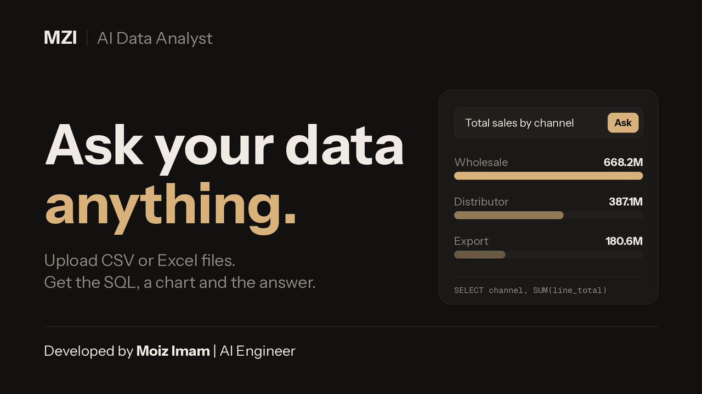

# MZI AI Data Analyst

Ask questions about your CSV and Excel files in plain English. The app writes the SQL, runs it on PostgreSQL, and shows the answer as a table, a chart and a short summary.

[](https://youtu.be/idlSsT0FuZI)

**Demo video (2:30):** https://youtu.be/idlSsT0FuZI

## What it does
- Upload several CSV or Excel files (`.csv`, `.xlsx`, `.xls`). Each file becomes its own PostgreSQL table.
- Ask a question such as "Top 5 customers by total sales". The app picks the right tables, joins them when needed, and shows the SQL it used.
- Get a result table, a chart (bar or line when it fits), a short summary, and Export CSV.
- Light and dark theme, a file manager, and clear error messages, including when the server is down.

## How it works
1. **Upload:** the file is read (UTF-8 or Latin-1 CSV, or Excel), cleaned (column names, empty rows, duplicates, spaces, numbers and dates detected) and saved as a PostgreSQL table. Column names, types and sample values are stored.
2. **Ask:** the schemas of the uploaded tables go to the LLM with your question, and it writes one SQL query.
3. **Check:** only a single SELECT on the uploaded tables is allowed, and a row limit is added.
4. **Run:** the query runs on a read-only connection with a 15-second time limit.
5. **Answer:** the rows are formatted, a chart type is chosen by simple rules, and the LLM writes a short summary from the returned rows.

## Tech stack
- **Backend:** Python, FastAPI, PostgreSQL (psycopg2), pandas, LangChain with Groq (`openai/gpt-oss-20b`)
- **Frontend:** React, Vite, TypeScript, Tailwind CSS, Recharts (built once and served by FastAPI)

## Run it locally
Requirements: Python 3.11+, Node.js 20.19+, PostgreSQL, and a [Groq](https://console.groq.com) API key.

```bash
git clone https://github.com/moiz-imam-buriro/mzi-ai-data-analyst.git
cd mzi-ai-data-analyst

python -m venv .venv
# Windows: .venv\Scripts\activate     macOS/Linux: source .venv/bin/activate
pip install -r requirements.txt
```

Create an empty database. The app creates its tables by itself on the first upload.

```sql
CREATE DATABASE ai_data_analyst;
```

Copy `.env.example` to `.env` and fill in your database password and Groq key. Then build the frontend and start the app:

```bash
cd app/frontend
npm install
npm run build
cd ../..
uvicorn app.fastapi_backend.main:app
```

Open http://127.0.0.1:8000, open **Files**, and upload your CSV or Excel files.

## Accuracy test
I tested the full pipeline (question, SQL, result) on 10 hand-written questions over 5 related sales files (`sales_order`, `Customers`, `Products`, `Regions`, `State_Regions`, with 64,104 order lines). Each answer is compared with the result of a hand-written SQL query: every value in the expected result must appear in the app's result.

The questions go from a simple total to joins across three tables, a year filter, a share of total with a window function, a monthly trend, a count with a threshold, a calculated profit column, and one question the data cannot answer (the app must refuse it). The model is a free 20B-parameter open model on Groq.

```
1. PASS  [basic]  What is the total sales amount?  (values match)
2. PASS  [join]  Top 5 customers by total sales  (values match)
3. PASS  [join + year filter]  What are the top 3 products by total sales in 2022?  (values match)
4. PASS  [join, must show the total]  Which state has the highest total sales?  (values match)
5. PASS  [3-table join]  Total sales by US region such as South, West, Northeast and Midwest  (values match)
6. PASS  [share of total (window)]  What percentage of total sales comes from each channel?  (values match)
7. PASS  [monthly trend (numbers only)]  Show the total sales for each month of 2023  (values match)
8. PASS  [having + count]  How many customers have total sales above 8 million?  (values match)
9. PASS  [calculated column]  What is the total profit for each channel, where profit is line total minus order quantity times total unit cost?  (values match)
10. PASS  [refusal]  How many orders were returned last month?  (refused, as expected)

Score: 10/10
```

This is a small test, and the prompts were tuned on similar questions during development, so it is not a blind test. LLM output can differ slightly between runs. The sales files are not included in this repository. To repeat the test, upload files with these exact names, then run `python -m tests.accuracy_test`.

## Limits
- The LLM can write wrong SQL. Use **View SQL** to check an answer.
- Built for a small set of related files (about 10). With many files the prompt gets too long.
- No user accounts: it is meant to run locally or in a private demo, not as a public service.
- Results are capped at 100 rows, and Export CSV exports the rows shown. Only the first Excel sheet is read.

## Project structure
```
app/
  ai/                SQL generation, summaries, chart choice
  database/          PostgreSQL connection, tables, read-only query runner
  file_processing/   reading and cleaning uploaded files
  fastapi_backend/   API routes and services
  frontend/          React app (built into app/frontend/dist)
tests/accuracy_test.py
requirements.txt
.env.example
```

## Author
Developed by **Moiz Imam** | AI Engineer